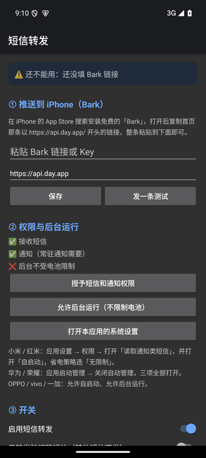

# 短信转发 SmsForward

把**自己**安卓手机收到的短信（尤其是验证码）实时推送到 iPhone。备用机不在身边，也能收到验证码。

*Forward SMS (especially one-time codes) from your own Android phone to your iPhone via [Bark](https://github.com/Finb/Bark) push notifications.*



## 功能

- 收到短信后几秒内推送到 iPhone（通过免费的 Bark App）
- 自动识别验证码，标题直接显示「验证码 123456」，点开通知自动复制
- 可选「只转发验证码短信」
- 断网时先存在本机，联网后自动补发（超过 3 天放弃）
- 双卡手机标出是哪张卡收到的
- 开机自启、常驻通知，防止被系统杀后台
- 本机保存最近 50 条转发记录，方便排查；可一键清空
- 体积小（约 700 KB），不依赖任何第三方库，只需要 Android 8.0 及以上

## 使用

### iPhone

1. App Store 安装 **Bark**（免费），打开并允许通知。
2. 复制首页那条 `https://api.day.app/xxxx/` 开头的链接，发到安卓手机上。
3. 建议在「设置 → 通知 → Bark」里打开「时效性通知」。

### 安卓

1. 从 [Releases](../../releases) 下载 APK 并安装。
2. 打开 App，按页面从上到下操作：粘贴 Bark 链接 → 保存 → 发一条测试；授予短信和通知权限；允许后台运行。
3. 顶部显示 **✅ 已就绪** 就可以了。

### 国产手机必须多做的一步

国产系统会拦截第三方 App 读取验证码短信，或者把 App 杀到后台。不做这一步，验证码很可能收不到。

| 手机 | 要打开的 |
|---|---|
| 小米 / 红米（MIUI、HyperOS） | 权限 → **读取通知类短信** 设为允许；**自启动**；省电策略 → **无限制** |
| 华为 / 荣耀 | 应用启动管理 → 本应用**关闭自动管理**，三个开关全打开 |
| OPPO / 一加 / realme | 允许自启动、允许后台运行；电池 → 不优化 |
| vivo / iQOO | 后台高耗电 → 允许；自启动 → 允许 |

设置完以后，把 App 从后台划掉，再找人给你发一条短信测试。

### 收不到怎么排查

打开 App 看「最近记录」：

- **有记录，但显示失败**：短信 App 已经收到，问题出在推送这一步，记录里会写原因，比如 Bark 链接填错了、或者网络不通。
- **完全没有记录**：系统没把短信交给 App，基本是上面那一步的权限没开，或者 App 被系统杀掉了。

## 隐私

- 短信内容只会发到你自己填的 Bark 服务器（默认是 `api.day.app`），再由 Apple 推送服务送到你的 iPhone。除此之外 App 不连接任何地方，没有统计，也没有广告。
- 你的 Bark 链接相当于「往你 iPhone 推消息的钥匙」，不要发给别人。
- 如果不想让短信经过公共服务器，可以[自己搭建 Bark 服务端](https://github.com/Finb/bark-server)，然后在 App 里把服务器地址改成你自己的。

## 自己编译

需要 JDK 17 和 Android SDK（compileSdk 35）。

```bash
./gradlew assembleRelease
```

生成的 APK 在 `app/build/outputs/apk/release/`。release 构建默认用本机 debug 证书签名，方便自己侧载；如果要分发给别人，请换成你自己的签名证书。

## 代码结构

| 文件 | 作用 |
|---|---|
| `SmsReceiver`（Receivers.kt） | 接收短信广播，把长短信拼回完整一条 |
| `Dispatcher` / `Forwarder`（Forwarder.kt） | 过滤、识别验证码、调用 Bark 推送 |
| `RetryJobService`（Receivers.kt） | 联网后补发失败的消息 |
| `KeepAliveService` | 常驻通知，保活 |
| `Store.kt` | 设置、转发记录、待补发队列（都存在本机） |
| `MainActivity` | 设置界面 |

## 声明

本项目只用来转发**你自己的**手机、在机主本人知情同意的前提下收到的短信。请勿用于获取他人短信或任何违法用途。

## 许可证

[MIT](LICENSE)
